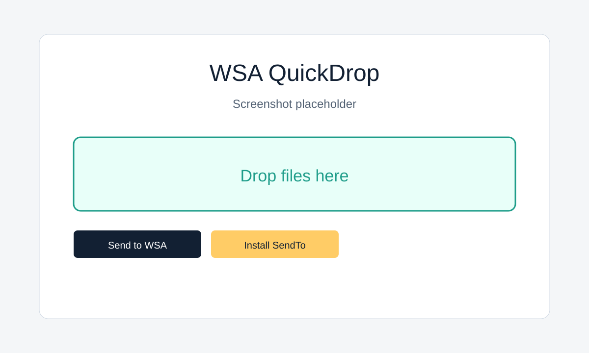

# WSA QuickDrop

Send files from Windows to WSA in one click.

WSA QuickDrop is a small Windows utility for sending images, PDFs, videos, audio, and documents into Windows Subsystem for Android storage using ADB. It is designed for the common case where an Android app inside WSA cannot easily see files from your Windows desktop.



## Features

- Right click one or more files in Explorer, then use `Send to > WSA QuickDrop`.
- Drag files into the app window or choose them with Browse Files.
- Routes files to Android-friendly folders:
  - Images: `/sdcard/Pictures/WSAQuickDrop`
  - PDFs and documents: `/sdcard/Download/WSAQuickDrop`
  - Videos: `/sdcard/Movies/WSAQuickDrop`
  - Audio: `/sdcard/Music/WSAQuickDrop`
- Supports custom Android paths below `/sdcard/`.
- Detects `adb.exe` from PATH, Android SDK locations, environment variables, or a saved custom path.
- Attempts to connect to WSA at `127.0.0.1:58526`.
- Attempts Android media scan after pushing files.
- Includes CLI, diagnostics, local logs, and optional HKCU context-menu scripts.
- No telemetry, no uploads, no cloud services.

## Install

Download the release zip, extract it, and run `WSAQuickDrop.exe`.

To install the recommended Explorer integration:

```powershell
powershell -ExecutionPolicy Bypass -File .\scripts\install_sendto.ps1
```

After that:

1. Select one or more files in Explorer.
2. Right click.
3. Choose `Send to > WSA QuickDrop`.

No admin rights are required.

## ADB Setup

WSA QuickDrop does not bundle ADB. Install Android SDK Platform-Tools, then either add `adb.exe` to PATH or select it in the app.

See [ADB setup](docs/ADB_SETUP_EN.md).

## WSA Setup

Open Windows Subsystem for Android settings, enable Developer Mode, and make sure WSA is running. The default ADB endpoint is:

```text
127.0.0.1:58526
```

See [WSA setup](docs/WSA_SETUP_EN.md).

## CLI

```powershell
WSAQuickDrop.exe --help
WSAQuickDrop.exe --send "C:\Users\User\Desktop\sample.jpg"
WSAQuickDrop.exe --send "file1.jpg" "file2.pdf" --target auto
WSAQuickDrop.exe --send "sample.pdf" --target downloads
WSAQuickDrop.exe --send "sample.jpg" --target pictures --connect 127.0.0.1:58526
WSAQuickDrop.exe --install-sendto
WSAQuickDrop.exe --uninstall-sendto
WSAQuickDrop.exe --list-devices
WSAQuickDrop.exe --diagnose
```

## Persian OCR Offline Preset

The app includes helper text for Persian OCR Offline testing. It does not require the app and does not depend on it.

Typical flow:

```text
Open Persian OCR Offline > Select Image/PDF > Pixel 5 > Pictures or Download > WSAQuickDrop
```

Known package IDs checked by the helper:

- `ir.persiandots.ocr.dev`
- `ir.persiandots.ocr`

## Troubleshooting

Run:

```powershell
WSAQuickDrop.exe --diagnose
```

For common fixes, see [troubleshooting](docs/TROUBLESHOOTING_EN.md).

## Build From Source

This repository uses Python 3.11+ with Tkinter because the local machine used to create the project had the .NET runtime but no .NET SDK.

```powershell
.\scripts\build_release.ps1
.\scripts\package_release.ps1
```

Tests run with:

```powershell
.\.venv\Scripts\python.exe -m pytest .\src\WSAQuickDrop.Tests
```

## Privacy

Files are sent locally through ADB. WSA QuickDrop does not upload files, collect analytics, or use telemetry. Logs stay under `%APPDATA%\WSAQuickDrop\logs`.

See [security and privacy](docs/SECURITY_PRIVACY.md).

## License

MIT
