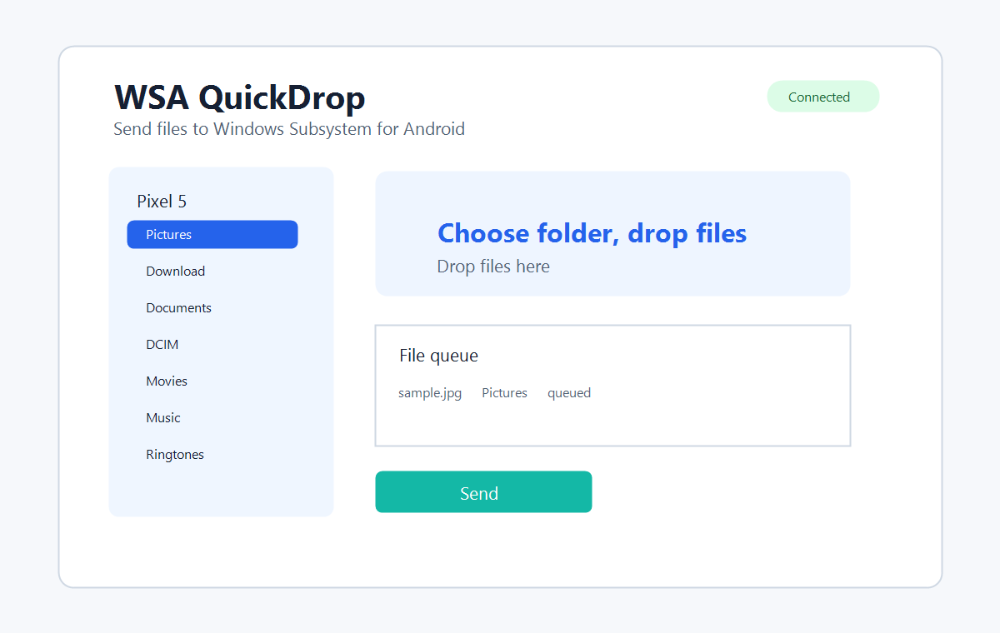

# WSA QuickDrop


**ارسال فایل از ویندوز به WSA با انتخاب تصویری پوشه اندروید.**

WSA QuickDrop یک ابزار کوچک ویندوزی است که به شما اجازه می‌دهد فایل‌ها را از ویندوز به Windows Subsystem for Android بفرستید؛ کافی است یک پوشه اندروید را به شکل تصویری انتخاب کنید و فایل‌ها را داخل برنامه رها کنید.



## این ابزار چه کاری انجام می‌دهد

- پوشه‌های Android را با نام ساده زیر Pixel 5 نشان می‌دهد.
- پوشه‌هایی مثل Pictures، Download، Documents، DCIM، Movies و Music را نمایش می‌دهد.
- با Drag & Drop یا Browse files فایل‌ها را صف می‌کند.
- گزینه `Send to > WSA QuickDrop` را بدون دسترسی Admin نصب می‌کند.
- مسیرهای فنی مثل `/sdcard` را در حالت عادی نشان نمی‌دهد.
- برای کاربران حرفه‌ای، نمایش مسیر Android در Settings قابل فعال‌سازی است.
- تله‌متری، آپلود، آنالیتیکس یا سرویس ابری ندارد.

## شروع سریع

1. Android SDK Platform-Tools را نصب کنید تا `adb.exe` در دسترس باشد.
2. Developer Mode را در Windows Subsystem for Android فعال کنید.
3. `WSAQuickDrop.exe` را باز کنید.
4. Connect را بزنید.
5. از Pixel 5 یک پوشه مثل Pictures یا Download را انتخاب کنید.
6. فایل‌ها را داخل برنامه رها کنید.
7. Send را بزنید.
8. داخل برنامه اندرویدی، از File Picker مسیر Pixel 5 > پوشه انتخاب‌شده را باز کنید.

## نصب SendTo

```powershell
powershell -ExecutionPolicy Bypass -File .\scripts\install_sendto.ps1
```

بعد از نصب:

```text
Right click > Send to > WSA QuickDrop
```

فایل‌ها داخل برنامه صف می‌شوند و به صورت پیش‌فرض بلافاصله ارسال نمی‌شوند، تا بتوانید پوشه مقصد را بررسی کنید.

## مثال CLI

```powershell
WSAQuickDrop.exe --send "sample.jpg" --folder Pictures
WSAQuickDrop.exe --send "sample.pdf" --folder Download
WSAQuickDrop.exe --send "sample.jpg" --folder "Pictures/My OCR Tests"
WSAQuickDrop.exe --list-folders
WSAQuickDrop.exe --create-folder Pictures "My OCR Tests"
WSAQuickDrop.exe --diagnose
```

## مثال برنامه OCR اندرویدی

1. در WSA QuickDrop پوشه Pictures را انتخاب کنید.
2. عکس را داخل برنامه رها کنید.
3. Send را بزنید.
4. برنامه OCR اندرویدی خود را داخل WSA باز کنید.
5. Select Image را بزنید.
6. مسیر Pixel 5 > Pictures را باز کنید و عکس را انتخاب کنید.

## رفع مشکل

راهنمای کامل در [TROUBLESHOOTING_FA.md](docs/TROUBLESHOOTING_FA.md) است.

اگر فایل سریع دیده نشد، داخل File Picker اندروید مستقیم به Pixel 5 > پوشه انتخاب‌شده بروید.

## حریم خصوصی

فایل‌ها فقط به صورت محلی از طریق ADB ارسال می‌شوند. برنامه فایل‌ها را آپلود نمی‌کند و تله‌متری ندارد. گزارش‌ها در `%APPDATA%\WSAQuickDrop\logs` ذخیره می‌شوند.

## مجوز

MIT
